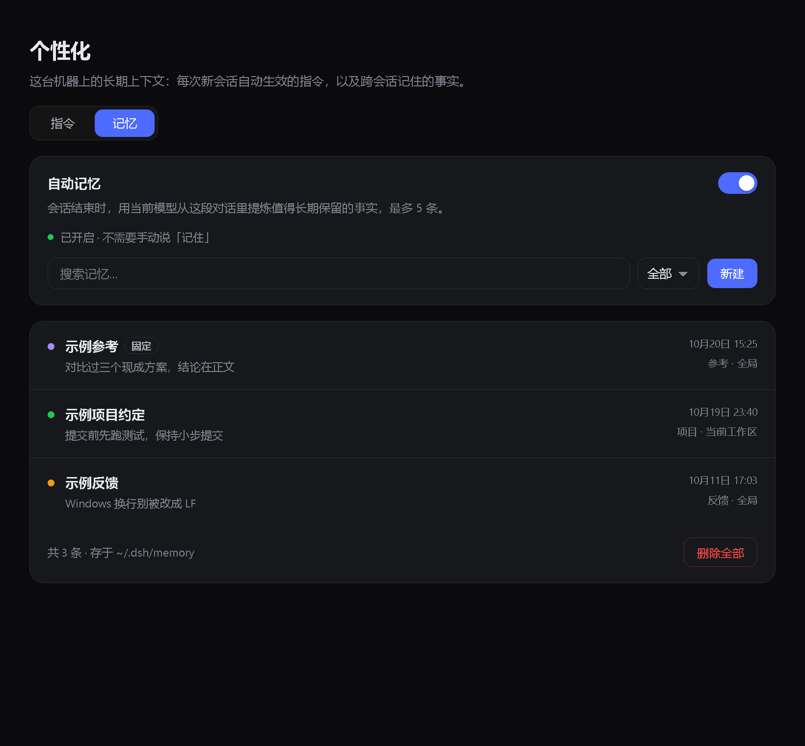
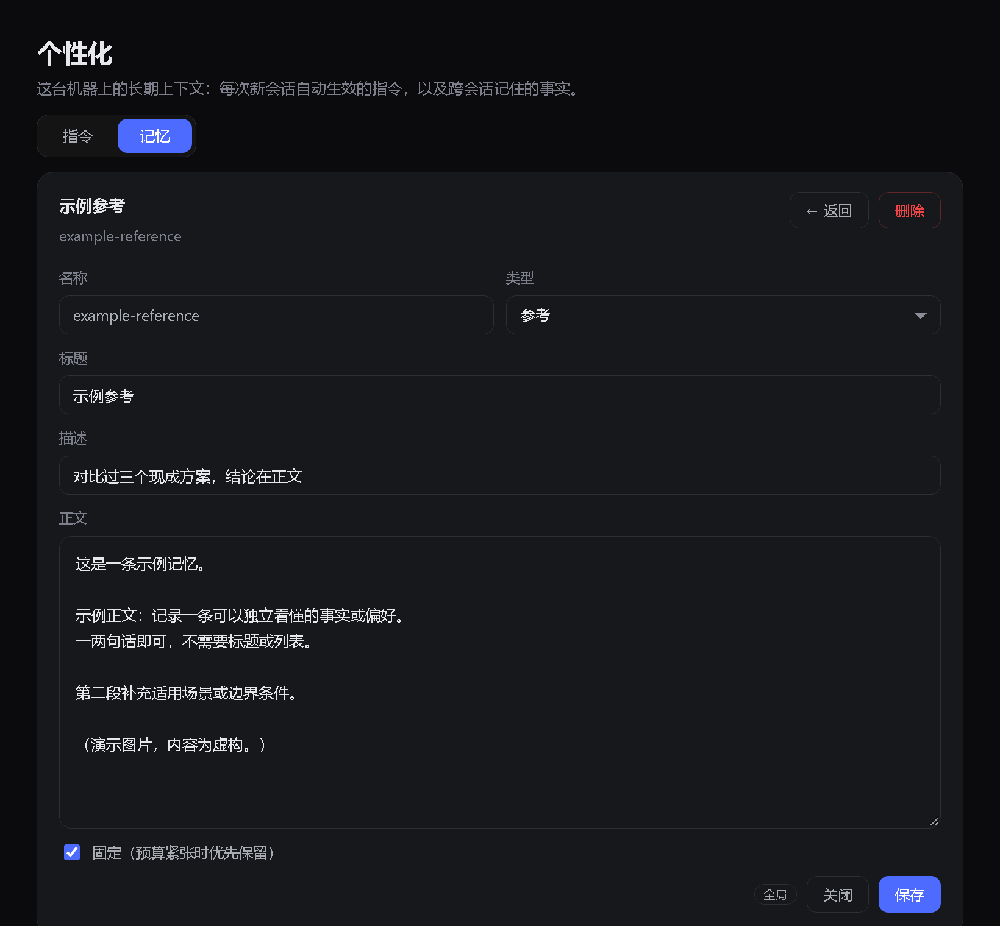
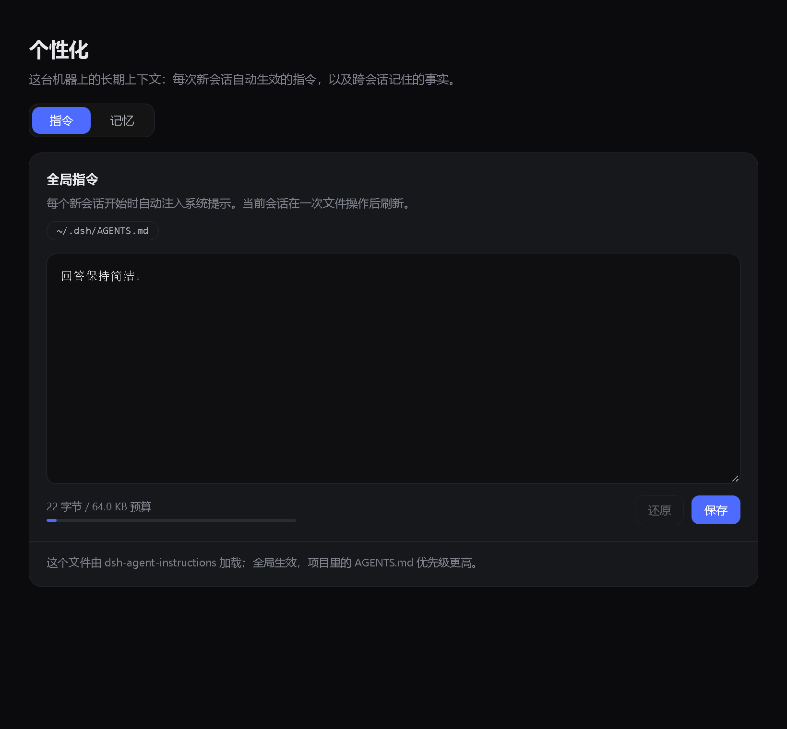

# dsh-personal-settings

One **Personalization** settings page for [DeepSeek Harness](https://github.com/deepseek-ai/deepseek-harness): keep long-lived instructions and long-lived memory in the same place.

[中文](README.md) | English



Today DSH auto-loads `AGENTS.md`/`CLAUDE.md` but ships no UI for them, and memory comes from separate plugins with separate panels. This plugin puts both behind one settings section:

- **Instructions** — edit `$DSH_HOME/AGENTS.md`, the file injected at the start of every new session
- **Memory** — browse, search, create, edit and delete what `dsh-auto-memory` has stored, plus a switch for automatic extraction

## Why

| | Stock DSH | This plugin |
|---|---|---|
| Edit global instructions | Find the file yourself | Edit in place, with a byte-budget bar |
| See what was remembered | Browse `~/.dsh/memory` | List + search + type/scope |
| Turn on auto-extraction | Edit YAML, restart | A switch on the page |





## Install

Requires DSH `0.2.x`. The memory half depends on [`dsh-auto-memory`](https://github.com/AskTheWay/dsh-auto-memory), so install it first:

```sh
dsh plugin --profile desktop add dsh-auto-memory
dsh plugin --profile desktop add "github:XEsx630/dsh-personal-settings"
```

Or from a local checkout: `dsh plugin --profile desktop add "file:/path/to/dsh-personal-settings"`.

Restart DSH; **Settings → 个性化 (Personalization)** appears.

### Optional: drop dsh-auto-memory's own sidebar entry

`dsh-auto-memory` adds its own "memory" sidebar panel, which duplicates this plugin's memory tab. The bundled script builds a host-only copy:

```sh
node scripts/headless-memory.mjs desktop
```

It copies the installed package, removes `lib/client.js` and the `dsh.client` field, then prints the two commands that swap it in. Host behaviour — index injection, `memory_*` tools, `/api/auto-memory/*`, auto-extraction — is untouched.

## Usage

### Instructions

Edits `$DSH_HOME/AGENTS.md` (`~/.dsh/AGENTS.md` by default). After saving:

- **New sessions** pick it up on their first step
- **The current session** rereads it after its next file operation, via the built-in `dsh-agent-instructions`

The byte counter is a per-file estimate against a 65,536-byte reference budget; the bar turns amber past 80%.

### Memory

Rows sort by pinned first, then most recently updated. Filter by text and by user/project scope. Clicking a row opens a dedicated editor:

- `name` is limited to `a-z0-9-` and cannot change after creation — it is the filename
- `description` is required and feeds the `MEMORY.md` index
- `type` drives the colour dot: user / feedback / project / reference
- Pinned memories are the last to be dropped when the injection budget is tight

### Auto-memory

The switch at the top controls `dsh-auto-memory`'s `autoSummarize`:

- When on, at the **end of a session** the current model distils up to five durable facts from the transcript in the background
- The switch writes the profile's `cordis.patch.yml`, then asks the cordis loader to **restart only the `auto-memory` entry** — no full DSH restart
- If the loader is unavailable it falls back to "restart required"; the config is already on disk either way

## Where the data lives

| Content | Path |
|---|---|
| Global instructions | `$DSH_HOME/AGENTS.md` |
| Memory files | `$DSH_HOME/memory/_user/*.md`, `$DSH_HOME/memory/--<project>--/*.md` |
| Memory index | `MEMORY.md` in the same directory |
| Injection audit | `$DSH_HOME/memory/audit.jsonl` |

Plain Markdown: hand-editable, greppable, git-friendly.

## Security

- Both host routes (`/dsh-personalization/api/*`) accept loopback `Host` headers only; instruction writes are capped at 256 KiB
- Instruction saves go through a temp file + rename, so a crash never leaves a half-written `AGENTS.md`
- The settings route does exactly two things: writes `autoSummarize: true|false` into the profile patch, then restarts that one entry; anything else is a 400
- The client makes no network requests beyond local routes

## Known limitations

- The memory tab needs `dsh-auto-memory`'s host routes. With only this plugin installed it shows a read error; the instructions tab is unaffected
- Auto-extraction fires when an **agent is disposed** (session switch, close, app exit), not every turn; it reads user/assistant text only, never tool calls or tool output
- UI copy is currently Chinese only
- Hot-restarting the entry relies on cordis loader's runtime update API — an internal interface that may shift on major DSH upgrades

## Development

No build step: `client.js` is a hand-written `window.__ModuleLoader__` bundle, `index.js` is plain Node ESM.

```sh
node --check index.js
node --check client.js
npm pack
```

Install a local checkout:

```sh
dsh plugin --profile desktop add "file:/path/to/dsh-personal-settings"
```

Edits to `client.js`/`index.js` need a DSH restart — a link install keeps the files live, but the running process does not hot-reload modules.

## License

[MIT](LICENSE)
